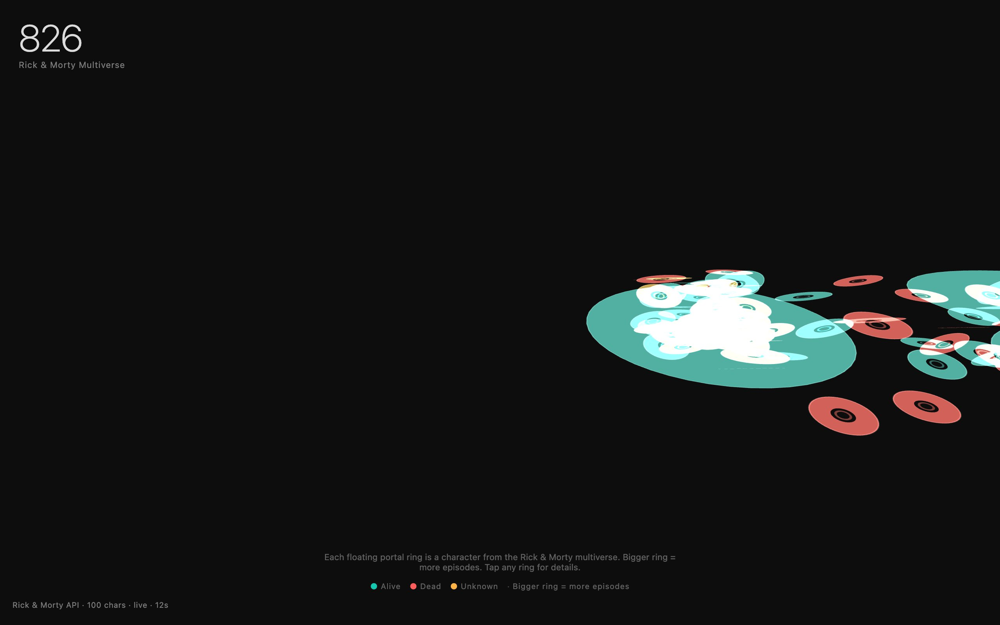

<div align="center">

<h1>rift</h1>

<p><b>The Rick and Morty cast as floating portals.</b></p>

<p><i>A hundred characters from the multiverse, each one a glowing ring sized by how often they show up.</i></p>

<h6>


</h6>

<a href="https://rift.parthchandak.info"><b>Live demo</b></a> ·
<a href="#how-it-works"><b>How it works</b></a> ·
<a href="#run-it"><b>Run it</b></a>

<br><br>

<a href="https://rift.parthchandak.info"></a>

<sub>Live capture, 22 October 2026, zoomed out slightly. Real API data.</sub>

</div>

<br>

On load the page fetches the first five pages of the public
[Rick and Morty API](https://rickandmortyapi.com) (100 characters) and turns each one into a
flat ring in a React Three Fiber scene. Rings spin and bob on their own while the camera slowly
orbits. The big 826 in the corner is the API's total character count; the stamp bottom-left
shows how many were actually loaded. No API key is needed.

## How it works

| Character field | Drives |
|---|---|
| `episode.length` | Ring width: the most-seen character gets the widest ring, everyone else scales down from there |
| `status` | Colour: teal for Alive, coral for Dead, gold for Unknown |
| `origin.name` | Cluster: characters from the same origin are placed around the same point |

Rings use additive blending, so where many overlap, as in the crowded `unknown` and Earth
origin clusters, they burn out to white. The clusters sit off to one side of the orbit centre, so
the field drifts across the frame as the camera turns.

Drag to orbit, scroll to zoom. Tap a ring and its name, species, status, episode count and
origin appear in the centre for three seconds. If the API is unreachable the page falls back to
a built-in list of 20 characters and the stamp says `cached` instead of `live`.

## Run it

```bash
git clone https://github.com/parthchandak02/rift.git
cd rift
npm install
npm run dev      # local dev server
npm run build    # static site in dist/
```

The live version runs on Cloudflare Pages.

<details>
<summary><b>Project layout</b></summary>

```
src/App.tsx                    Canvas, camera, orbit controls, initial fetch
src/data/characters.ts         API fetch, fallback list, page count
src/components/PortalField.tsx Places rings in clusters by origin
src/components/PortalRing.tsx  One ring: size, colour, spin, bob, click
src/components/Chrome.tsx      Headline number, legend, data stamp
src/components/QuietZone.tsx   The tap-to-reveal character card
src/store/index.ts             Zustand store
```

</details>

<br>

<div align="center">
<sub>Built with React Three Fiber, drei, Three.js and Vite. Data from the Rick and Morty API.</sub>
</div>
